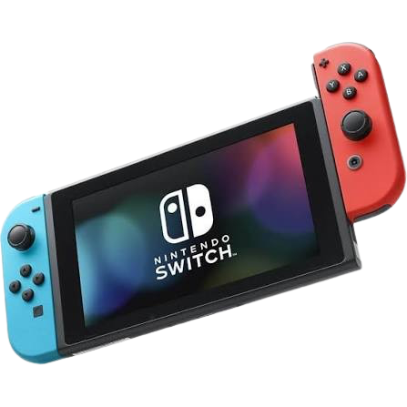
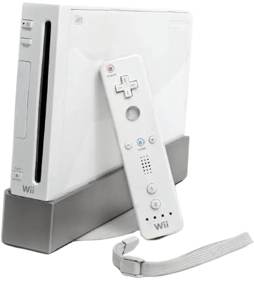

# Moddable & Homebrewable Devices

A community-maintained index of consoles, handhelds, and hardware that can be jailbroken, softmodded, or hardmodded to run custom firmware (CFW) and homebrew software.

> **Want to add or update a device?**
> Do **not** edit `README.md` directly—it is automatically generated. Instead, copy `template.yml` into the appropriate category folder under `src/devices/` and submit a Pull Request.

---

## Understanding the Fields

Each device entry tracks key requirements and risk levels before you begin:

* **Type:** `Softmod` (software-only exploit) or `Hardmod` (requires physical hardware modification or soldering).
* **Difficulty:** `Easy` (beginner-friendly, drag-and-drop files), `Intermediate` (requires specific hardware revisions, payloads, or multi-step downgrades), or `Difficult` (micro-soldering or high-precision hardware work).
* **Firmware:** Supported system software versions.
* **Reversible:** Whether the device can be cleanly restored to stock firmware.
* **Brick Risk:** Likelihood of permanently damaging the device if steps are followed incorrectly (`none`, `unlikely`, or `likely`).

## Video Game Consoles

---

### Nintendo 3DS
**Type:** Softmod · **Difficulty:** Easy · **Firmware:** 1.0.0 - 11.17.0 · **Reversible:** Yes · **Brick Risk:** Unlikely
* **Tools:** SD card (4GB or larger), SD card reader, PC, Mac, or Android device, Magnet (only required for ntrboot method)
* **Links:** [Guide](https://3ds.hacks.guide) • [CFW](https://github.com/LumaTeam/Luma3DS)
* **Notes:** Supports all models (Old 3DS, 2DS, New 3DS, New 2DS XL). MSET9 and super-skaterhax cover the latest firmwares.

---

### Nintendo DSi
**Type:** Softmod · **Difficulty:** Easy · **Firmware:** 1.4 - 1.4.5 · **Reversible:** Yes · **Brick Risk:** Unlikely
* **Tools:** SD card (2GB or larger, FAT32 formatted), SD card reader, PC or Mac
* **Links:** [Guide](https://dsi.cfw.guide) • [CFW](https://github.com/DS-Homebrew/TWiLightMenu)
* **Notes:** Uses the Memory Pit exploit via the Nintendo DSi Camera app, followed by Unlaunch for coldbooting directly into TWiLight Menu++.

---

### Nintendo Switch (OLED / Lite / V2)
**Type:** Hardmod · **Difficulty:** Difficult · **Firmware:** 1.0.0 - 19.0.1 · **Reversible:** No · **Brick Risk:** Likely
* **Tools:** Picofly (RP2040) or Instinct-NX modchip, Soldering iron with fine tip and flux, Microscope or magnifying glass, Tri-wing and Phillips, microSD card
* **Links:** [Guide](https://switch.hacks.guide) • [CFW](https://github.com/Atmosphere-NX/Atmosphere)
* **Notes:** Requires micro-soldering directly to motherboard capacitors and flex cables. OLED models require the DAT0 adapter or Kamikaze method.

---

### Nintendo Switch (Unpatched V1)

**Type:** Softmod · **Difficulty:** Intermediate · **Firmware:** 1.0.0 - 19.0.1 · **Reversible:** Yes · **Brick Risk:** Unlikely
* **Tools:** RCM Jig, USB-C to USB-A/C data cable, microSD card (64GB or larger recommended), PC, Mac, or Android phone (payload injector)
* **Links:** [Guide](https://switch.hacks.guide) • [CFW](https://github.com/Atmosphere-NX/Atmosphere)
* **Notes:** Only applies to early Erista (V1) units manufactured before mid-2018 vulnerable to the Fusee Gelee exploit. Newer Switch models require a modchip.

---

### Nintendo Wii

**Type:** Softmod · **Difficulty:** Easy · **Firmware:** 4.3 · **Reversible:** Yes · **Brick Risk:** Unlikely
* **Tools:** SD card (2GB or larger, formatted to FAT32), SD card reader, Internet connection (for str2hax DNS exploit)
* **Links:** [Guide](https://wii.hacks.guide) • [CFW](https://github.com/HomebrewChannel/hbc)
* **Notes:** Can be modded using LetterBomb (requires MAC address and SD card) or str2hax (requires no SD card initially, only a DNS change).

---

### Nintendo Wii U
**Type:** Softmod · **Difficulty:** Easy · **Firmware:** 5.5.0 - 5.5.6 · **Reversible:** Yes · **Brick Risk:** Unlikely
* **Tools:** SD card (32GB or larger recommended, FAT32 formatted), SD card reader, PC or Mac
* **Links:** [Guide](https://wiiu.hacks.guide) • [CFW](https://github.com/wiiu-env/Aroma)
* **Notes:** Uses the browser-based JS Type Confusion exploit to install Aroma CFW and PayloadLoader for coldboot functionality.

---

### PlayStation 4

**Type:** Softmod · **Difficulty:** Easy · **Firmware:** 1.00 - 11.00 · **Reversible:** Yes · **Brick Risk:** None
* **Tools:** USB flash drive (exFAT formatted), Ethernet cable and PC (required for 9.03 - 11.00 PPPwn exploit)
* **Links:** [Guide](https://consolemods.org/wiki/PS4:PS4_Mods_Wiki) • [CFW](https://github.com/GoldHEN/GoldHEN)
* **Notes:** Jailbreak is tethered and must be re-applied after a full reboot. Firmware 9.00 uses a USB/WebKit exploit; 11.00 uses the PPPwn Ethernet exploit.

---

### PlayStation Vita
**Type:** Softmod · **Difficulty:** Easy · **Firmware:** 3.60 - 3.74 · **Reversible:** Yes · **Brick Risk:** Unlikely
* **Tools:** Internet connection (for HENlo browser exploit), Official Sony Memory Card (required for OLED 1000 models), SD2Vita adapter + microSD card (recommended for storage)
* **Links:** [Guide](https://vita.hacks.guide) • [CFW](https://github.com/TheOfficialFloW/henkaku)
* **Notes:** Firmware 3.74 can be hacked directly via the built-in web browser without a PC, then downgraded to 3.65 for permanent Enso CFW.

---

### Sony PlayStation 3

**Type:** Softmod · **Difficulty:** Easy · **Firmware:** 4.80 - 4.91 · **Reversible:** Yes · **Brick Risk:** Unlikely
* **Tools:** USB flash drive (FAT32 formatted), PC or Mac, Internet connection on the PS3
* **Links:** [Guide](https://consolemods.org/wiki/PS3:PS3_Mods_Wiki) • [CFW](https://www.psx-place.com/forums/ps3-jailbreak-cfw-and-ps3hen.86/)
* **Notes:** Fat models and early Slim models (CECH-20xx to 25xx) support full CFW (Evilnat). Late Slims and Super Slims only support PS3HEN.

---

### Sony PlayStation Portable (PSP)
**Type:** Softmod · **Difficulty:** Easy · **Firmware:** 6.60 - 6.61 · **Reversible:** Yes · **Brick Risk:** None
* **Tools:** Memory Stick PRO Duo (or microSD to Memory Stick adapter), Mini-USB cable or card reader, PC or Mac
* **Links:** [Guide](https://www.pspunk.com/psp-cfw/) • [CFW](https://github.com/PSP-Archive/ARK-4)
* **Notes:** All PSP models (1000, 2000, 3000, Go, Street) can run permanent ARK-4 CFW via Infinity or cIPL.

## Home Automation

---

### Echo Dot 2nd Gen

**Type:** Softmod · **Difficulty:** Easy · **Firmware:** any · **Reversible:** Yes · **Brick Risk:** Unlikely
* **Tools:** USB Cable, Computer
* **Links:** [Guide](https://github.com/Gamer92000/echo-dot-assist)
* **Notes:** Requires a working Home Assistant server and pipeline.

---

### Google Nest Learning Thermostat (Gen 1 / Gen 2)
**Type:** Hardmod · **Difficulty:** Difficult · **Firmware:** 1.0 - 5.9 · **Reversible:** Yes · **Brick Risk:** Likely
* **Tools:** Torx T5 screwdriver, Plastic spudger / pry tool, Micro-USB cable (for DFU / omap_loader mode), Linux PC or Raspberry Pi
* **Links:** [Guide](https://github.com/codykociemba/NoLongerEvil-Thermostat) • [CFW](https://github.com/codykociemba/NoLongerEvil-Thermostat)
* **Notes:** Bypasses Google's discontinued cloud servers on older Nest units via USB DFU mode to inject a custom Linux kernel and local API, restoring local control and Home Assistant integration.

---

## Contributing

1. Fork the repository and create a new branch.
2. Copy `template.yml` into the matching category folder inside `src/devices/` (e.g., `src/devices/handhelds/my-device.yml`).
3. Fill out all required fields using valid YAML syntax. Ensure all URLs start with `https://`.
4. Open a Pull Request with a brief summary of your addition or update.

## Disclaimer

All hardware and software modifications carry inherent risk. **Always verify your exact model number, board revision, and current firmware version** before running exploits or flashing custom firmware. Neither the maintainers nor contributors are responsible for bricked devices, voided warranties, or banned online accounts.
